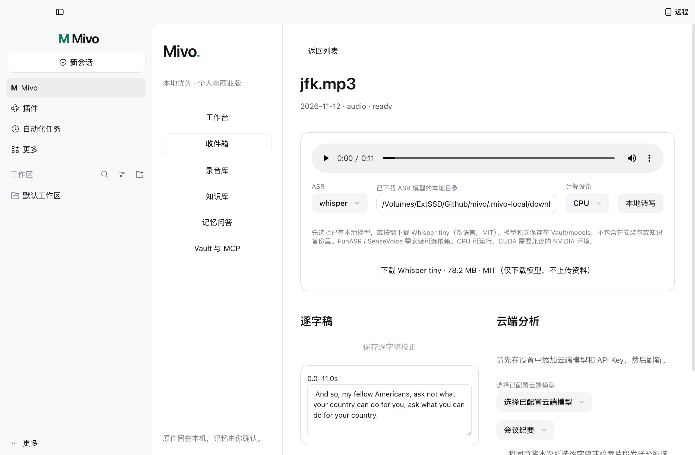
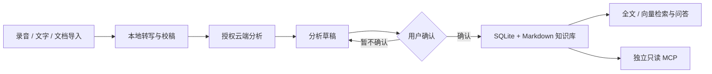

<p align="center">
  
</p>

<h1 align="center">Mivo · 声藏</h1>
<p align="center"><strong>Your Personal AI Memory</strong><br />Capture Everything. Remember Anything.</p>
<p align="center">把录音与文字变成可追溯、可检索、由你掌握的个人知识。</p>
<p align="center">
  <a href="LICENSE-MIVO"></a>
  <a href="mivo/docs/licensing.md"></a>
  <a href="mivo/docs/acceptance.md"></a>
  <a href="https://FDEChina.ai"></a>
</p>
<p align="center">
  <a href="#快速开始">快速开始</a> · <a href="mivo/README.md">使用手册</a> · <a href="mivo/docs/architecture.md">开发文档</a> · <a href="CONTRIBUTING.md">参与贡献</a> · <a href="https://github.com/bingyue/mivo/issues">问题反馈</a>
</p>

> **许可范围：** Mivo 原创代码采用 **Apache-2.0**。当前桌面版基于社区 DeepSeek Harness Desktop，仍受其 MIT 及非商业衍生附加条款约束。**完整桌面版不是纯 Apache-2.0 项目，也不因此获得商业衍生许可。** 详情见[许可说明](mivo/docs/licensing.md)。

## Mivo 是什么

Mivo 是本地优先的个人 AI 记忆工作台。录音、文档和笔记保存到独立的 **Mivo Vault**；本机完成语音转写，云端模型在明确授权后生成分析草稿，只有你确认的内容才进入长期知识库。

Mivo 复用 DeepSeek Harness 的 Agent、模型配置、凭据、插件、Skills 和工具调用能力，同时将个人知识与 DSH 会话数据分开保存。Mivo Core 可以独立运行，未来更换桌面壳或 Agent Runtime 时，知识库仍然属于你。



*截图来自实际 macOS 应用，使用公开测试录音；不是静态界面示意图。*

## 核心流程



- **本地资料入口**：导入音频、视频、TXT、Markdown、PDF、DOCX、HTML、JSON、CSV，或直接输入笔记；原件按 SHA-256 去重。
- **本地语音转写**：Whisper 使用 CPU 或兼容 CUDA 环境；模型按需下载并校验，不默认使用收费云端转写。源码环境保留 FunASR / SenseVoice 扩展。
- **有证据的分析**：会议纪要、深度洞察、战略顾问、反方思考、行动提取、知识提取、内容创作和个人复盘八种模板，关联来源与逐字稿版本。
- **确认后才记住**：分析先保存为草稿，人工确认后写入 Markdown、SQLite 和检索索引；AI 不覆盖原始录音。
- **可追溯问答**：本地全文检索、商业 Embedding API、混合召回，以及带来源与时间范围的回答入口。
- **独立 MCP**：9 个只读工具，连接范围限于指定 Vault，可供支持 MCP 的客户端使用。
- **数据可带走**：JSON 导出、Markdown 文件、完整备份、空目录恢复和全文索引重建。

## 当前状态

当前为 **0.1.0 MVP 预览版**。实现、测试通过与待验证的能力分别记录，不将接口存在视为验收完成。

| 范围 | 当前证据 |
| --- | --- |
| macOS Apple Silicon | 原生应用与 DMG 构建、安装后重启、本地数据持久化已测试；未签名、未公证 |
| Windows x64 | 已提供 NSIS 构建配置和手动工作流，尚未完成 Windows 实机验收 |
| Mivo Core / MCP | 真实 SQLite、文件、HTTP、进程与 MCP SDK 测试，详见[验收记录](mivo/docs/acceptance.md) |
| 本地 Whisper | 真实录音 CPU 转写、原音播放、校稿和模型下载已验证 |
| 云端 AI | 已复用 DSH Provider 与 Agent；DeepSeek 模型列表接口连通性已验证，实际分析与跨录音回答仍待验收 |
| 商业 Embedding | 已实现兼容 API 和混合检索，真实服务验收仍待配置 |

尚未验证 CUDA、FunASR / SenseVoice、真实麦克风和长会议录音准确率；没有说话人分离或 Metal 推理支持。第一版不提供本地 LLM、云同步、多用户、移动 App 或复杂知识图谱。请先使用测试资料评估。

## 快速开始

### 获取源码

```sh
git clone --recurse-submodules git@github.com:bingyue/mivo.git
cd mivo
```

也可以使用 HTTPS 地址 `https://github.com/bingyue/mivo.git`。保留子模块与锁文件，避免与不兼容的上游版本混用。

### 独立运行 Mivo Core

需要 [uv](https://docs.astral.sh/uv/) 和 Python 3.11。Core 不需要桌面壳或 DSH 才能进行导入、转写、检索、备份与 MCP 访问。

```sh
uv sync --project mivo/core --extra whisper
uv run --project mivo/core --extra whisper mivo-core --vault /absolute/path/to/MivoVault
```

Core 只监听本机回环地址，启动时输出连接握手和随机访问令牌。不要把握手内容贴到公开 Issue。桌面版自动管理这个进程；独立 HTTP 使用方式见[架构说明](mivo/docs/architecture.md)。

### 构建桌面版

需要 Node.js ≥ 24.9、pnpm 11.7.0、Rust stable 和 uv。macOS 需要 Xcode Command Line Tools；Windows 需要 MSVC Build Tools。首次安装依赖需要联网。

```sh
git submodule update --init --recursive
pnpm install --frozen-lockfile --ignore-scripts
pnpm mivo:test
pnpm mivo:build
```

`mivo:build` 检查桌面许可模式、准备固定版本 Runtime、冻结 Core，并按平台打包。默认 `MIVO_DISTRIBUTION_MODE=personal_noncommercial`；当前桌面壳的 `commercial` 构建会被拒绝。这一门禁不限制独立 Apache-2.0 Mivo Core 的许可。

macOS 本地启动：

```sh
open apps/desktop/src-tauri/target/release/bundle/macos/Mivo.app
```

产物位于 `apps/desktop/src-tauri/target/release/bundle/`。本仓库首批公开内容为源码，不提供经过发行合规审核的公共安装包；本地构建记录不等于公开发行授权。

## 配置模型

### 云端大模型：复用 DSH

在桌面应用的模型设置中添加提供商。对提供 **OpenAI Chat Completions 兼容协议**的云服务，使用现有“自定义提供商”，填写：

1. Provider ID 与显示名称。
2. 服务商提供的 Base URL。
3. API 协议：`OpenAI Chat Completions`。
4. API Key 与实际模型 ID；支持模型发现的服务可获取模型列表，也可手动添加。

可用于 DeepSeek、OpenAI，以及提供相应兼容接口的 Qwen、GLM、Kimi 等服务。Claude 可走 DSH 的 Anthropic 协议或对应服务商的兼容网关。是否支持流式响应、工具调用与特定参数取决于服务商和模型，**不宣称所有供应商均已实测**。分析工具链需要模型支持工具调用。

DeepSeek 官方 Base URL 为 `https://api.deepseek.com`；本次模型列表查询返回 `deepseek-flash`、`deepseek-v4-pro`。请以服务商当前文档和账号实际可用模型为准，参见 [DeepSeek API 文档](https://api-docs.deepseek.com/)。

Mivo 不重复实现模型管理器，不在源码或 Vault 中保存另一份 LLM 密钥。没有模型配置也能使用本地导入与转写。生成草稿或回答前，界面会明确提示哪些文字将发送到所选云端服务。

### 商业 Embedding

为启动 Mivo 的进程配置以下环境变量，再重启应用：

| 变量 | 内容 |
| --- | --- |
| `MIVO_EMBEDDING_URL` | 服务商完整的 HTTPS embeddings 接口地址 |
| `MIVO_EMBEDDING_MODEL` | 实际 Embedding 模型 ID |
| `MIVO_EMBEDDING_API_KEY` | 通过本机环境或秘密管理器注入的密钥 |

在「Vault 与 MCP」中授权建立向量索引。只发送已确认知识片段；语义查询还会发送查询文字。聊天模型与 Embedding 服务是独立配置，没有向量服务时仍可使用全文检索。

## 连接 MCP 客户端

先创建 Vault。在支持 stdio MCP 的客户端中使用以下配置，将路径替换为本机绝对路径；桌面版也会显示打包后的真实 Core 命令。

```json
{
  "mcpServers": {
    "mivo": {
      "command": "uv",
      "args": [
        "--directory", "/absolute/path/to/mivo",
        "run", "--project", "mivo/core",
        "mivo-mcp", "--vault", "/absolute/path/to/MivoVault"
      ]
    }
  }
}
```

工具包括 `search_memories`、`list_recordings`、`get_transcript`、`get_memory`、`get_topic_context`、`get_person_context`、`get_project_context`、`get_timeline`、`search_tasks`。没有写入工具；连接外部 AI 客户端意味着允许它读取工具返回的内容。

## 数据与隐私

```text
MivoVault/
├── originals/      原始录音、视频和文档
├── transcripts/    版本化逐字稿
├── knowledge/      确认后的 Markdown 知识
├── database/       SQLite、全文索引、向量和任务
├── models/         独立 ASR 模型，不进入知识备份
├── exports/        导出内容
└── backups/        含校验清单的完整备份
```

原始音频默认不上传。分析草稿不会自动进入永久记忆。Mivo Core 与 MCP 限制访问已授权 Vault，DSH Agent 通过受限业务工具读取资料，不把 Vault 直接作为 Shell 工作目录。

本地运行不等于系统级安全沙箱：本机管理员、其他有文件权限的应用，以及用户主动安装的插件仍可能访问文件。请仅安装可信插件。安全问题的报告方式见 [SECURITY.md](SECURITY.md)。

## 开发与贡献

| 目录 | 职责 |
| --- | --- |
| `mivo/core` | 独立记忆引擎、本地 API、ASR 和 MCP |
| `packages/mivo-memory` | DSH Host 插件、受限工具、模型与 Core 连接 |
| `packages/mivo-workbench` | Mivo 工作台 UI 插件 |
| `packages/mivo-bundle` | 插件装配和分析 Skills |
| `apps/desktop` | 保留上游许可的桌面壳及应用层修改 |
| `source/deepseek-harness` | 未修改的官方 DSH 子模块 |
| `mivo/docs` | 审计、架构、许可和真实验收记录 |

```sh
pnpm mivo:test
pnpm --filter mivo-memory typecheck
pnpm --filter mivo-workbench typecheck
```

接口改动后按[开发说明](mivo/docs/architecture.md)生成 Mivo API。云端综合验收使用[独立脚本](mivo/docs/cloud-acceptance.md)，显式执行才会产生服务商 API 用量。自动 CI 不需要 API Key，也不调用付费模型。

欢迎提交可复现问题、测试、文档和代码改进。请先阅读 [CONTRIBUTING.md](CONTRIBUTING.md)；近期工作与已知限制见 [CHANGELOG.md](CHANGELOG.md) 和[验收记录](mivo/docs/acceptance.md)。

## 作者

- **作者：邴越** · GitHub [@bingyue](https://github.com/bingyue)
- **全网 IP：越哥聊AI**
- **FDE 前线：[FDEChina.ai](https://FDEChina.ai)**

## 许可证与致谢

Mivo 原创代码使用 [Apache License 2.0](LICENSE-MIVO)，版权与适用范围见 [NOTICE](NOTICE)。使用、修改和再分发第三方部分时，仍须遵守它们各自的许可证。

当前社区桌面壳保留 [LICENSE](LICENSE) 与 [LICENSE.details](LICENSE.details)；桌面壳衍生改动和对应补丁不被重新标记为 Apache-2.0。独立 Mivo Core 与包含受限桌面壳的整套应用，是不同的许可范围。商业桌面衍生需取得上游许可或替换受限壳，详见[许可说明](mivo/docs/licensing.md)和[第三方声明](mivo/THIRD_PARTY_NOTICES.md)。

感谢 [DeepSeek Harness](https://github.com/deepseek-ai/deepseek-harness)、[社区桌面壳](https://github.com/dsh-tauri/deepseek-harness-desktop)、Whisper、faster-whisper、FunASR、MCP、SQLite 及其他依赖项目。上游历史、许可证和[原始 README](README.upstream.md)均保留。Mivo 是独立项目，不代表 DeepSeek 官方产品或背书。
